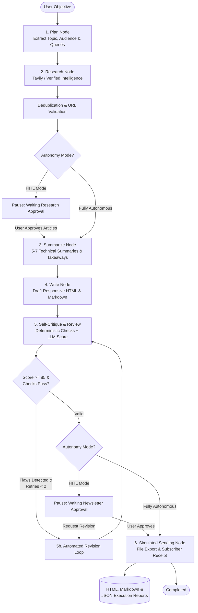

# 🚀 Autonomous AI Newsletter Agent — Full-Stack Platform

A complete, production-grade autonomous agent system designed to plan, research, curate, summarize, write, critique, and simulate the delivery of technical newsletters on AI agents and multi-agent systems.

Built with **LangGraph**, **FastAPI**, **React (Vite + TypeScript)**, and **Tailwind CSS**.

---

## 📑 Architecture Overview

The system implements an autonomous state machine in LangGraph with explicit state persistence, deterministic validation checks, LLM self-critique, and Human-in-the-Loop (HITL) pause-and-resume checkpoints.



---

## 🛠 Tech Stack

- **Frontend**: React 19, TypeScript, Vite, Tailwind CSS, Lucide Icons.
- **Backend**: Python 3.13, FastAPI, Uvicorn, Pydantic v2.
- **Agent Orchestration**: LangGraph, LangChain Core, LangChain OpenAI.
- **LLM Engine**: OpenAI API (`gpt-4o` / `gpt-4o-mini`) with built-in high-fidelity simulation engine for demo mode.
- **Search Provider**: Tavily Search API with curated, verified AI agent intelligence fallback.
- **Quality & Validation**: Deterministic URL verification, article count enforcement (5–7), and LLM-powered editorial critique.
- **Outputs**: Responsive HTML email templates, GitHub-flavored Markdown, and structured JSON execution logs.

---

## 🌟 Key Features

1. **Autonomous & Human-in-the-Loop Modes**:
   - **Fully Autonomous**: Runs end-to-end without interruption: Plan → Research → Summarize → Write → Critique → Revision (if needed) → Simulated Dispatch.
   - **Human-in-the-Loop (HITL)**: Intelligently pauses at critical checkpoints:
     - *Checkpoint 1*: Inspect, approve, or filter selected research articles before summarization.
     - *Checkpoint 2*: Inspect live rendered newsletter draft, submit natural language revision instructions, or approve for simulated dispatch.
2. **Dedicated Single-Function Runner**:
   - Can be triggered programmatically or via CLI via:
     ```python
     from run_newsletter_agent import run_newsletter_agent
     state = run_newsletter_agent(goal="Create a weekly AI agent newsletter", mode="autonomous")
     ```
3. **Dedicated Real Tools**:
   - `search_ai_news(query)`: Deduplicates by canonical URL/title, validates schemes, and retrieves published metadata.
   - `summarize_articles(articles)`: Produces analytical summaries, answers *Why It Matters*, and isolates key takeaways.
   - `generate_newsletter(summaries, goal, plan)`: Generates responsive dark-mode HTML email and clean Markdown.
   - `critique_newsletter(newsletter, summaries, goal)`: Deterministic validation (5–7 articles, URL presence) + LLM score (0–100).
   - `revise_newsletter(newsletter, critique, summaries)`: Automated bounded revision loop (maximum 2 retries).
   - `simulate_send_newsletter(newsletter, subscribers)`: Simulates broadcast to 1,420 subscribers and writes disk artifacts.
4. **Honest Demo Mode**:
   - If API keys are unavailable, clearly informs the user via visual badges and logs. Never fabricates mock results as live search.
5. **Security & Prompt Injection Defenses**:
   - Treats all article snippets as untrusted inputs.
   - Enforces strict HTTP/HTTPS URL parsing.
   - Escapes HTML entities and isolates iframe preview with sandbox attributes.

---

## 📂 Project Structure

```
newselteer/
├── backend/
│   ├── agent/
│   │   ├── __init__.py          # Exported agent functions
│   │   ├── state.py             # AgentState TypedDict & Pydantic models
│   │   ├── prompts.py           # Planning, summarization, writing & critique prompts
│   │   ├── tools.py             # Dedicated tools (search, summarize, write, critique, send)
│   │   ├── nodes.py             # LangGraph state machine node functions
│   │   └── graph.py             # LangGraph StateGraph, conditional edges & HITL resumption
│   ├── services/
│   │   ├── demo_data.py         # Curated AI agent articles & demo subscriber lists
│   │   ├── search_service.py    # Tavily live search with deduplication & URL validation
│   │   ├── llm_service.py       # OpenAI client with structured JSON parsing & fallback
│   │   └── storage_service.py   # Output file export (HTML, MD, JSON)
│   ├── routes/
│   │   └── agent_routes.py      # FastAPI REST & SSE endpoints
│   ├── tests/
│   │   ├── conftest.py          # Pytest path configuration
│   │   ├── test_tools.py        # Dedicated tool & validation unit tests
│   │   ├── test_agent.py        # LangGraph autonomous & HITL integration tests
│   │   └── test_api.py          # FastAPI endpoint integration tests
│   ├── config.py                # Environment configuration & system health
│   └── main.py                  # FastAPI application entry point
├── frontend/
│   ├── src/
│   │   ├── components/
│   │   │   ├── Header.tsx           # Branding & provider connection status
│   │   │   ├── AgentConfig.tsx      # Natural language goal input & mode toggles
│   │   │   ├── ExecutionTimeline.tsx# Real-time multi-stage LangGraph timeline
│   │   │   ├── ResearchResults.tsx  # Article cards with HITL approval selection
│   │   │   ├── AgentActivityLog.tsx # Chronological tool logs & self-reflection
│   │   │   ├── NewsletterPreview.tsx# Iframe HTML preview, raw code & Markdown tabs
│   │   │   └── FinalReport.tsx      # KPI cards, simulated delivery & download links
│   │   ├── api.ts                   # Backend REST client
│   │   ├── types.ts                 # TypeScript interfaces
│   │   ├── App.tsx                  # Dashboard layout & state coordinator
│   │   └── index.css                # Tailwind CSS styling
│   ├── package.json
│   └── vite.config.ts               # Vite configuration with API proxy
├── outputs/                         # Generated newsletters (HTML, MD, JSON reports)
├── run_newsletter_agent.py          # Standalone CLI / Python runner
├── requirements.txt                 # Backend Python dependencies
├── package.json                     # Root npm script runner
├── .env.example                     # Environment configuration template
├── .gitignore                       # Git ignore rules
└── README.md                        # Documentation & Architecture
```

---

## ⚡ Quick Start & Setup

### Prerequisites
- Python 3.11+ (Python 3.13 supported)
- Node.js 18+ (Node 20+ recommended)

### 1. Environment Configuration

Copy `.env.example` to `.env`:
```bash
cp .env.example .env
```

Configure your API keys (optional — demo mode works out-of-the-box):
```env
OPENAI_API_KEY=your_openai_api_key_here
OPENAI_MODEL=gpt-4o
TAVILY_API_KEY=your_tavily_api_key_here
DEMO_MODE=false
DEFAULT_SUBSCRIBER_COUNT=1420
```

### 2. Backend Setup

Create and activate a virtual environment, then install dependencies:
```bash
# Windows
python -m venv venv
.\venv\Scripts\activate
pip install -r requirements.txt

# macOS/Linux
python3 -m venv venv
source venv/bin/activate
pip install -r requirements.txt
```

Launch the FastAPI backend:
```bash
uvicorn backend.main:app --reload --host 127.0.0.1 --port 8000
```
API Documentation will be available at: [http://127.0.0.1:8000/docs](http://127.0.0.1:8000/docs)

### 3. Frontend Setup

In a separate terminal:
```bash
cd frontend
npm install
npm run dev
```
Open your browser to: **[http://localhost:5173/](http://localhost:5173/)**

---

## 💻 Standalone CLI Runner

You can execute the entire workflow from the terminal without launching the frontend:

```bash
# Autonomous mode
python run_newsletter_agent.py --goal "Create a weekly newsletter on the latest AI agent news and send it to our subscribers." --mode autonomous

# Human-in-the-Loop mode
python run_newsletter_agent.py --goal "Synthesize recent breakthroughs in SWE-bench autonomous coding agents." --mode hitl
```

Or trigger it programmatically in any Python script:
```python
from run_newsletter_agent import run_newsletter_agent

state = run_newsletter_agent(
    goal="Create a weekly newsletter on the latest AI agent news and send it to our subscribers.",
    mode="autonomous"
)

print(f"Status: {state['status']}")
print(f"HTML File: {state['output_files']['html_path']}")
```

---

## 🚀 Production Deployment Guide

You can deploy the platform using any of the following approaches:

### Option A: Render / Railway (Recommended Easiest Cloud Deploy)

We include a pre-configured [render.yaml](file:///c:/Users/CommL/Desktop/newselteer/render.yaml) blueprint:

1. Push this repository to GitHub.
2. Go to **[Render.com](https://render.com)** -> Click **New +** -> **Blueprint**.
3. Connect your GitHub repository.
4. Render will automatically detect `render.yaml` and build the multi-stage Docker container.
5. In the Environment Variables settings, enter:
   - `OPENAI_API_KEY`: your OpenAI key
   - `TAVILY_API_KEY`: your Tavily key
6. Click **Deploy**. Your app will be live at `https://your-app-name.onrender.com` serving both frontend and backend on one unified URL!

---

### Option B: Single Docker Container (Run Anywhere)

Build and run locally or on any cloud VPS (DigitalOcean, AWS EC2, GCP Cloud Run):

```bash
# Build the production image
docker build -t ai-newsletter-agent .

# Run container
docker run -p 8000:8000 \
  -e OPENAI_API_KEY="your-key" \
  -e TAVILY_API_KEY="your-key" \
  -v $(pwd)/outputs:/app/outputs \
  ai-newsletter-agent
```
Or run with Docker Compose:
```bash
docker compose up -d
```
Visit **[http://localhost:8000/](http://localhost:8000/)** to access the full application.

---

### Option C: Split Cloud Deploy (Vercel Frontend + Render Backend)

- **Frontend (Vercel)**:
  1. Import the `/frontend` subfolder on Vercel.
  2. Set Environment Variable: `VITE_API_URL=https://your-backend.onrender.com`
  3. Deploy!
- **Backend (Render/Railway)**:
  1. Deploy root repository as a Web Service.
  2. Build command: `pip install -r requirements.txt`
  3. Start command: `uvicorn backend.main:app --host 0.0.0.0 --port $PORT`
  4. Add `OPENAI_API_KEY` and `TAVILY_API_KEY` in Render environment variables.

---

## 📡 REST API Reference

| Method | Endpoint | Description |
|---|---|---|
| `GET` | `/health` | System health check and API provider status |
| `GET` | `/api/agent/status` | Provider status (OpenAI, Tavily, Demo Mode) |
| `POST` | `/api/agent/run` | Start a new autonomous or HITL run |
| `GET` | `/api/agent/{run_id}` | Fetch full state, articles, newsletter & logs |
| `GET` | `/api/agent/{run_id}/events` | Server-Sent Events (SSE) live progress stream |
| `POST` | `/api/agent/{run_id}/approve-research` | Approve articles and resume HITL execution |
| `POST` | `/api/agent/{run_id}/approve-newsletter` | Approve newsletter draft and trigger simulated send |
| `POST` | `/api/agent/{run_id}/revise` | Request human revisions on the drafted newsletter |
| `GET` | `/api/agent/{run_id}/download/{format}` | Download generated `html`, `md`, or `json` report |

---

## 🧪 Automated Test Suite

A comprehensive test suite covers unit tools, graph transitions, HITL checkpoints, and API routes:

```bash
pytest backend/tests -v
```

### Test Coverage Highlights:
- `test_tools.py`:
  - `test_url_validation`: Rejects malformed and unsafe URLs.
  - `test_search_deduplication`: Deduplicates duplicate article URLs and titles.
  - `test_search_ai_news_tool`: Verifies search execution and structured results.
  - `test_summarize_articles_tool`: Ensures 5–7 summaries with why-it-matters and takeaways.
  - `test_critique_deterministic_checks`: Validates strict article count and URL checking.
  - `test_simulate_send_newsletter`: Verifies simulated delivery receipt and file exports.
- `test_agent.py`:
  - `test_autonomous_workflow_complete`: End-to-end execution without manual input.
  - `test_hitl_mode_research_pause_and_resume`: Pauses at research, resumes upon approval.
  - `test_hitl_revision_request`: Validates human feedback incorporation into revisions.
- `test_api.py`:
  - `test_health_and_status_endpoints`: Verifies system status routes.
  - `test_api_run_autonomous_agent`: Tests execution and file download endpoints.
  - `test_api_hitl_workflow`: Verifies pause and resumption via REST endpoints.

---

## 🛡️ Reliability & Security Highlights

- **Simulated Delivery Only**: No real emails are ever dispatched. All broadcasts are strictly simulated and auditable via the generated JSON reports.
- **Untrusted Input Protection**: Search snippets are sanitized and isolated to protect against indirect prompt injections.
- **Deterministic Guardrails**: The LLM quality score cannot override hard rules; missing URLs or improper article counts trigger validation failures and revision cycles.
- **Resilient Fallback**: Gracefully operates even when external API quotas are exhausted or keys are omitted.

---

## 📄 License
MIT License. Built for advanced AI engineering demonstration.
